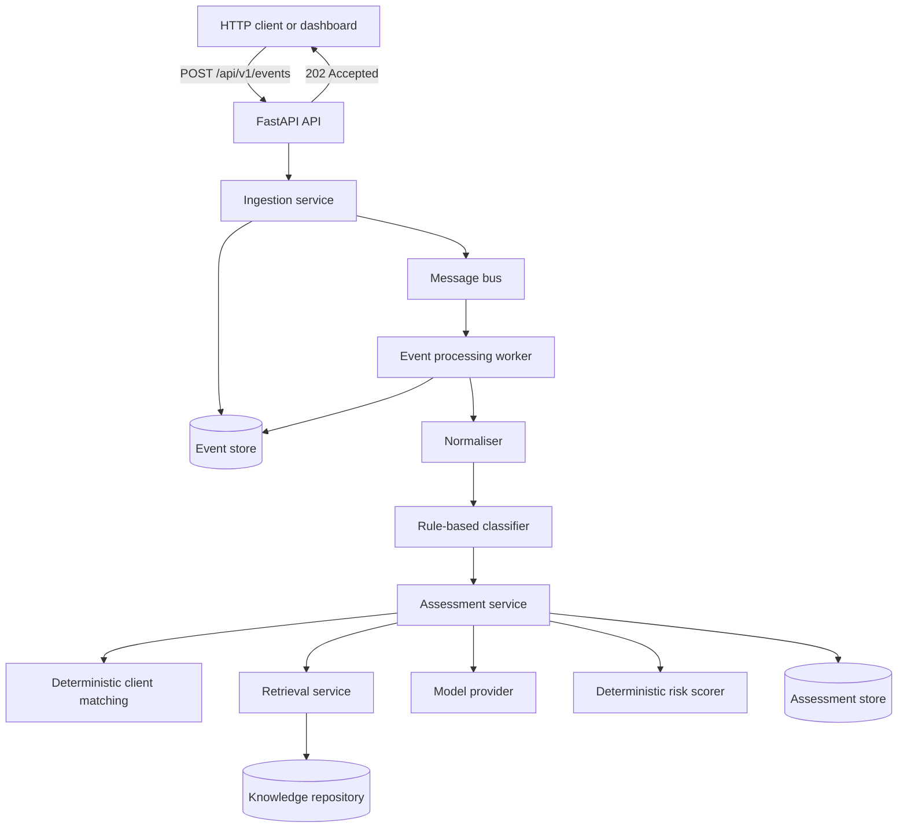

# Aegis: Client Fragility & Stress Testing

**Finds structural fragility in a client's dependencies: concentration, contagion, convexity and optionality. No prediction.**

External events can expose structural weaknesses in organisations and live projects. Conventional risk scoring focuses on event severity and geographical exposure, often overlooking the underlying characteristics that determine whether an organisation can absorb, adapt to, or benefit from disruption. Aegis addresses this through organisational fragility characterisation: understanding dependencies, concentration, substitutability, operational slack, nonlinear thresholds and interdependencies. Drawing on Taleb's concepts of fragility, concavity and convexity, the objective is to understand not simply what might happen, but why an organisation may be structurally vulnerable to it.

This is a platform in active development, with a local zero-dependency path, optional Google Cloud adapters, and a Cloud Run deployment. The repository contains the working event-processing pipeline, a React dashboard, unit, integration, contract and evaluation tests, and deployment manifests. Alongside the API, a self-contained `metrics/` package computes structural-fragility readings (concentration, contagion, convexity, optionality) on YAML dependency graphs — locally, with no cloud services. Those metrics find structural weaknesses; they do not forecast events.

<!-- TODO: measured evaluation scores, latency, and cost once a live-model run is recorded -->

## Quick start

### Prerequisites

- Python 3.12+
- pip
- (optional) Docker, for Compose and emulators
- (optional) Node.js 18+, for the dashboard

### Structural-fragility metrics (local)

Plain Python, no API or cloud. From the repo root after `pip install -r requirements.txt`:

```bash
# One metric
PYTHONPATH=. python -m metrics.hhi --graph metrics/examples/four_equal_suppliers.yaml

# Every metric, grouped (Concentration / Contagion / Convexity / Optionality)
# No blended score — each group shows its worst status; ruin forces red.
PYTHONPATH=. python -m metrics.run_all --graph metrics/examples/chain_abc.yaml

# Tests for the metrics package
PYTHONPATH=. python -m pytest metrics/tests -q
```

Other metric modules: `metrics.monoculture`, `metrics.single_points_of_failure`, `metrics.cascade_depth`, `metrics.convexity`, `metrics.ruin`, `metrics.optionality`, `metrics.slack`. Example graphs live in `metrics/examples/`. Status thresholds are documented defaults in `metrics/thresholds.py`.

**Ruin survival floor.** Ruin fires when remaining deliverable flow at any stress-ladder rung is strictly below `floor × F₀`. Default floor is **0.5** (a client is usually finished well before total loss). Override per graph with top-level YAML `survival_floor:`, or on the CLI with `--survival-floor` (wins over YAML):

```bash
PYTHONPATH=. python -m metrics.ruin --graph metrics/examples/single_supplier.yaml --survival-floor 0.6
```

### Backend

```bash
cd aegis-client-fragility
pip install -r requirements.txt
cp .env.example .env
PYTHONPATH=. python -m backend.main
```

Or, if you have `make`:

```bash
make install
cp .env.example .env
make dev
```

On Windows PowerShell, set the path before starting the API:

```powershell
pip install -r requirements.txt
Copy-Item .env.example .env
$env:PYTHONPATH = "."
python -m backend.main
```

The API listens on `http://localhost:8000`. Interactive docs: `http://localhost:8000/docs`. Health: `http://localhost:8000/health`.

Default configuration uses the deterministic model provider, SQLite, an in-memory message bus, and lexical retrieval. No API key is required for this path. See `.env.example` for the full list of settings.

### Submit a test event

```bash
curl -X POST http://localhost:8000/api/v1/events \
  -H "Content-Type: application/json" \
  -d '{
    "source": "manual",
    "title": "Major oil sanctions imposed on Gulf producer",
    "raw_content": "The international community has imposed sweeping oil sanctions on a major Gulf producer following military escalation. Energy infrastructure is at risk. OPEC meeting called.",
    "event_date": "2026-11-15T00:00:00",
    "affected_regions": ["middle_east"],
    "tags": ["geopolitical", "energy", "sanctions"]
  }'
```

The API returns `202 Accepted` immediately. The worker processes the event asynchronously. Status moves through `pending → normalised → classified → processing → assessed` (or `failed`). Poll with:

```bash
curl http://localhost:8000/api/v1/events/{event_id}
curl http://localhost:8000/api/v1/dashboard/summary
```

### Dashboard (optional)

```bash
cd frontend
npm install
npm run dev
```

The Vite dev server has no API proxy. The dashboard reads `VITE_API_BASE` (see `frontend/.env.example`). If that variable is unset, it falls back to the deployed Cloud Run API (`https://aegis-api-343322260451.europe-west2.run.app`). For a fully local dashboard:

```bash
cp frontend/.env.example frontend/.env
# default in the example is http://localhost:8000
```

As of 20 November 2026, 09:47 Europe/London, `GET /health` on that Cloud Run service returned `{"status":"healthy",...}` with the deterministic provider and 29 indexed documents. There is no verified public URL for the frontend in this repository.

### Docker

```bash
docker-compose up --build
```

Optional emulators:

```bash
docker-compose --profile pubsub up
docker-compose --profile firestore up
```

## Architecture

A FastAPI service accepts external events and returns `202 Accepted`. An asynchronous worker then normalises and classifies events, retrieves supporting evidence, and generates schema-validated assessment text. Client matching, classification and risk scoring are deterministic. Persistence and messaging sit behind port interfaces, with SQLite and an in-memory bus for local development, and Firestore / Pub/Sub adapters for Google Cloud Run.

The intended evolution of this pipeline is to generate schema-validated shock profiles and evaluate their interaction with persistent, client-specific Fragility Registers. The `metrics/` package already provides the deterministic structural readings (HHI, monoculture, SPOFs, cascade depth, Taleb convexity / Jensen gap, ruin, optionality, slack) for YAML dependency graphs. Structured intelligence models would characterise organisational dependencies for those registers; LLMs support evidence interpretation and profile elicitation, while business decisions and mathematical calculations remain independently testable and deterministic.

The diagram below is the pipeline that is in the repository today.



Processing is genuinely asynchronous: the API and the worker share only the message bus and the persistence stores, not an in-process call chain (see [ADR-003](docs/decisions/ADR-003-async-processing.md)).

### Components

| Area | Role |
|---|---|
| `backend/api` | FastAPI app, routers (`/health`, `/api/v1/events`, `/api/v1/dashboard`), dependency container |
| `backend/ingestion` | Idempotency check, persist event, publish to the bus |
| `backend/event_processing` | Normaliser, rule-based classifier, async worker |
| `backend/assessment` | Client matching, retrieval, model call, persistence of the assessment |
| `backend/retrieval` | Evidence retrieval against the knowledge repository |
| `backend/decision_engine` | Deterministic risk scorer |
| `backend/model_gateway` | `DeterministicModelProvider` (default) and `GeminiModelProvider` |
| `backend/persistence` | SQLite and Firestore stores; in-memory and Pub/Sub emulator buses; lexical knowledge repository |
| `backend/shared` | Pydantic models, port interfaces, configuration, logging |
| `metrics/` | Structural-fragility metrics on YAML dependency graphs (HHI, monoculture, SPOF, cascade depth, convexity, ruin, optionality, slack). No forecasting, no blended score. |
| `frontend` | React, TypeScript, Vite, Tailwind, TanStack Query dashboard: dashboard, events, event detail, assessments, submit event |
| `data/synthetic` | Synthetic clients, projects, regional profiles, industry context, intelligence reports |
| `data/evaluation` | Labelled evaluation, adversarial, and held-out event sets |
| `infrastructure` | Dockerfiles and Cloud Run service YAML for the API and the worker |
| `docs/decisions` | ADRs 001–004 |
| `tests` | Unit, integration, contract, and evaluation tests |

### Port and adapter matrix

| Port | Local / default | Cloud / optional |
|---|---|---|
| Event store | SQLite | Firestore |
| Assessment store | SQLite | Firestore |
| Message bus | In-memory `asyncio.Queue` | Pub/Sub emulator, and a Pub/Sub setting for Cloud Run |
| Model provider | Deterministic (no API key) | Gemini (`GEMINI_API_KEY` required) |
| Knowledge repository | Lexical (BM25-style) | `bge_m3` is listed in configuration, but no BGE-M3 adapter is present in the tree |

Configuration is via environment variables or `.env`. Important switches: `MODEL_PROVIDER`, `PERSISTENCE_BACKEND`, `MESSAGE_BUS_TYPE` / `MESSAGE_BUS_BACKEND`, `RETRIEVAL_BACKEND`, `SQLITE_DB_PATH`, `CORS_ALLOWED_ORIGINS`. `GEMINI_API_KEY` is required only for the Gemini provider.

`CORS_ALLOWED_ORIGINS` is a comma-separated allowlist of browser origins. It defaults to local Vite dev and preview origins (`http://localhost:5173`, `http://127.0.0.1:5173`, `http://localhost:4173`, `http://127.0.0.1:4173`). Pushing to `master` does not auto-deploy to Cloud Run. This repository does not record a public dashboard URL, so before the next API deploy set `CORS_ALLOWED_ORIGINS` on the `aegis-api` Cloud Run service to the live dashboard origin. If that variable is left unset on deploy, browsers on a hosted dashboard will be blocked.

## Design decisions and trade-offs

These are recorded in the ADRs and summarised here.

**Ports, not adapters, in business logic** ([ADR-001](docs/decisions/ADR-001-local-persistence.md), [ADR-002](docs/decisions/ADR-002-model-provider-abstraction.md)). Services depend on interfaces. The container in `backend/api/dependencies.py` is where concrete adapters are constructed. SQLite was chosen as the default store so local development and tests need no Docker; Firestore can be selected without changing service code.

**Business decisions and mathematical calculations stay deterministic** ([ADR-002](docs/decisions/ADR-002-model-provider-abstraction.md)). Client matching, classification, and risk scoring are independently testable and are not left to the model. Model output must validate against a Pydantic schema or it is rejected. Provider name and model version are stored on each assessment. As the platform evolves, LLMs are intended to support evidence interpretation, profile elicitation and consequence analysis on the same terms.

**Async ingestion** ([ADR-003](docs/decisions/ADR-003-async-processing.md)). `POST /api/v1/events` persists and enqueues, then returns `202`. Callers poll for status. This isolates ingestion from assessment failures and allows the worker to scale independently.

**Cloud Run API and worker as separate services** ([ADR-004](docs/decisions/ADR-004-deployment.md)). The API is ingress-facing; the worker is intended to consume the queue. Production persistence is Firestore; production messaging is Pub/Sub. Local development can stay on SQLite and the in-memory bus, or opt into emulators. Secrets are intended to live in Secret Manager in production, not in the repository.

**Trade-offs already accepted in the ADRs.** SQLite concurrency is enough for a local proof of the pipeline, not for a large multi-writer deployment. Cloud Run worker cold starts of one to three seconds are treated as acceptable for this workload. The Firestore Python SDK is synchronous and is wrapped with `asyncio.to_thread`.

## Testing

```bash
PYTHONPATH=. pytest tests/                  # all tests, including evaluation
PYTHONPATH=. pytest tests/unit/
PYTHONPATH=. pytest tests/integration/
PYTHONPATH=. pytest tests/contract/
PYTHONPATH=. pytest tests/ -m "not evaluation"
```

Or `make test`, `make test-unit`, `make test-integration`, `make test-contract`, and `make lint` (`ruff check backend/ tests/`).

- Unit tests cover models, the classifier, the normaliser, the scorer, and client matching.
- Integration tests cover the event and assessment pipelines and the dashboard API. Pub/Sub emulator and Firestore adapter tests skip unless `PUBSUB_EMULATOR_HOST` or `FIRESTORE_EMULATOR_HOST` is set.
- Contract tests lock port behaviour for the knowledge repository, model provider, and retrieval.
- Evaluation tests in `tests/evaluation/` exercise labelled, adversarial, and held-out events. Several are marked `evaluation` so they can be excluded from the default CI run. They use the deterministic provider and local data; they do not require a live Gemini key.

`ruff` is configured in `pyproject.toml` but is not listed in `requirements.txt`, so install it separately for local linting (`pip install ruff`).

## Deployment

Cloud Run service manifests live in `infrastructure/cloud_run/`. Dockerfiles live in `infrastructure/docker/`. There is no Terraform directory in this repository, even though earlier checkpoint notes referred to one.

## Current status

The root README previously marked checkpoints 2–4 as pending. The code is ahead of that table.

| Area | Status in the current tree |
|---|---|
| Data contracts, ports, local adapters, vertical slice | Present |
| Pub/Sub emulator adapter and expanded tests | Present |
| Gemini provider and evaluation datasets / tests | Present |
| Lexical retrieval | Present |
| BGE-M3 retrieval | Configured as an option; adapter not in the tree |
| React dashboard | Present (17–18 November 2026) |
| Firestore adapters and Cloud Run YAML | Present |
| Terraform | Not in the repository |
| Fragility Registers, shock profiles, nonlinear stress-testing | Not in the tree — foundation for later implementation |
| GitHub Actions | `.github/workflows/ci.yml` (lint and tests) |

## Limitations and next steps

- Nonlinear fragility measurement, convexity characterisation and antifragility assessment remain areas for implementation and empirical validation. Client-specific Fragility Registers and a deterministic stress-testing engine for nonlinear response, slack depletion, threshold crossings and cascading consequences are not in this tree yet.
- Knowledge in the repo is synthetic. There is no live event-feed integration in this tree.
- The default model is a deterministic stand-in. Gemini is implemented, but live-model quality, latency, and cost have not been published here.
- Retrieval is lexical. A `bge_m3` setting exists without a matching adapter.
- The dashboard API base is configurable via `VITE_API_BASE`. If unset, it still falls back to the current Cloud Run API URL, so existing builds keep working. For local development, set it to `http://localhost:8000` as in `frontend/.env.example`.
- CORS is an allowlist (`CORS_ALLOWED_ORIGINS`), defaulting to local Vite origins. A deployed dashboard origin is not in this repository; set that variable on Cloud Run to the live dashboard origin before the next API deploy, or browsers on the hosted dashboard will be blocked.
- `pyproject.toml` declares the project as proprietary. There is no `LICENSE` file. Decide explicitly if this should stay closed or be opened.
- Cloud Run YAML and the frontend contain the GCP project id / number for the current deployment. That is already in the public tree; treat it as a known exposure of infrastructure identifiers, not of keys.

## Repository layout

```
backend/           API, ingestion, worker, assessment, retrieval, scoring, adapters
frontend/          React + TypeScript dashboard
data/synthetic/    Local knowledge base and client/project fixtures
data/evaluation/   Labelled evaluation sets
docs/architecture/ Component map
docs/decisions/    ADR-001 to ADR-004
infrastructure/    Dockerfiles and Cloud Run YAML
tests/             unit, integration, contract, evaluation
```

## Documentation

- [Architecture overview](docs/architecture/overview.md)
- [ADR-001 Local persistence](docs/decisions/ADR-001-local-persistence.md)
- [ADR-002 Model provider abstraction](docs/decisions/ADR-002-model-provider-abstraction.md)
- [ADR-003 Asynchronous processing](docs/decisions/ADR-003-async-processing.md)
- [ADR-004 Deployment](docs/decisions/ADR-004-deployment.md)
